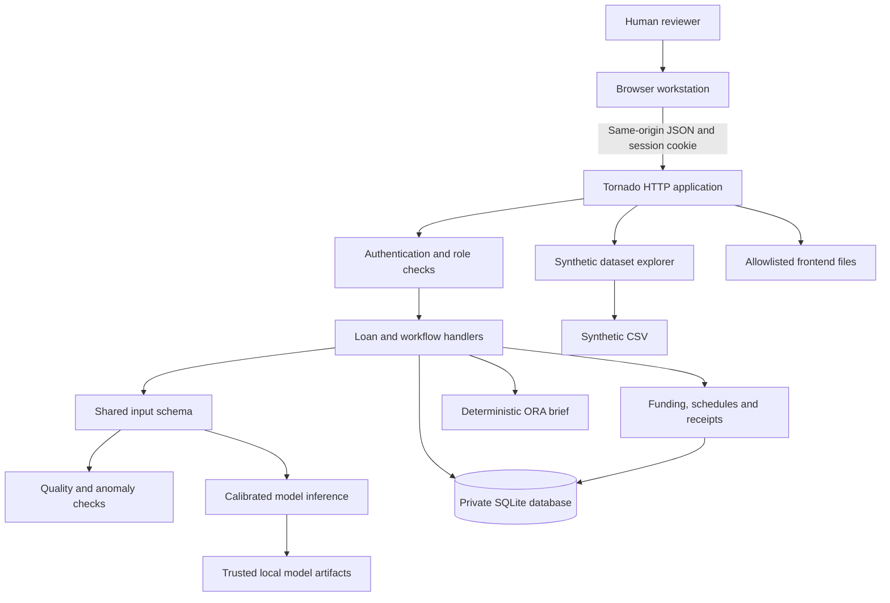
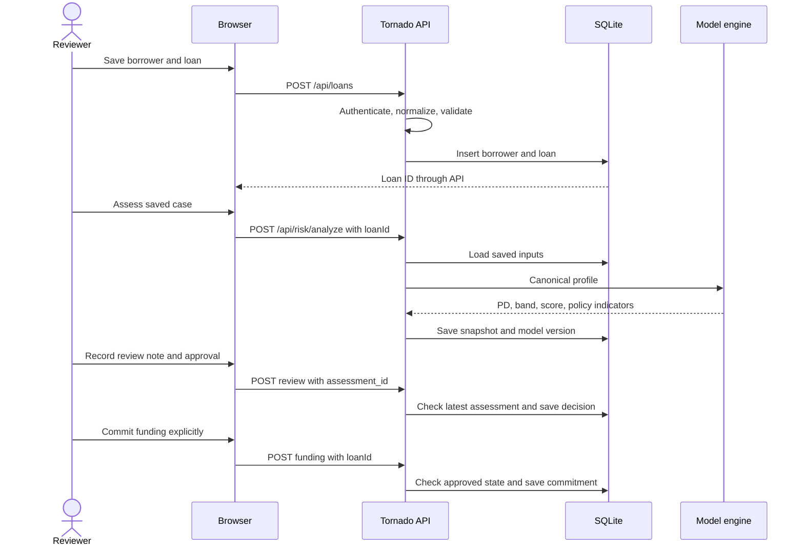
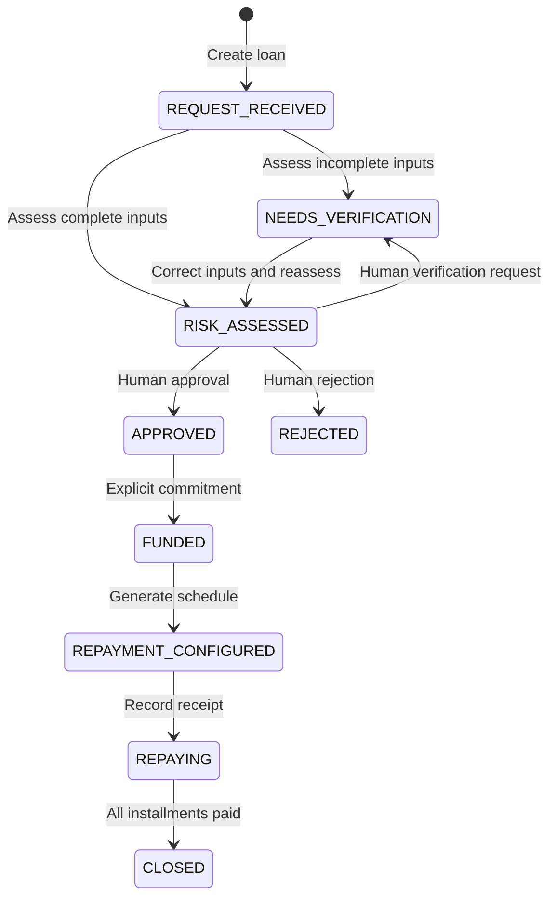

# Architecture

This document describes the integrated application as implemented in October 2026. Module names and stored states refer to the running Tornado system. The OraAgent ZIP contributed workflow ideas and adapted components; its separate FastAPI application is not a second service in this architecture.

## System context

One Python process serves both the frontend and API. There is no required cloud service, LLM API, message broker, bank API or frontend build service. SQLite holds workflow state. The synthetic CSV supports training and exploration; it is not the loan transaction database.

## Component responsibilities

| Component | Responsibility | Important boundary |
|---|---|---|
| `run.py` | Validate assets and start the server | Never silently retrains |
| `backend/config.py` | Resolve environment settings | Paths independent of launch directory |
| `backend/server.py` | HTTP orchestration, risk, funding, repayment and analytics | Checks workflow state before writes |
| `backend/integration.py` | Setup, accounts, profile edits, human review and audit reads | Review tied to current assessment |
| `backend/schema.py` | Canonical names, aliases, conversion, validation and inference defaults | Missing storage values are not invented |
| `backend/security.py` | Password hashes and session creation/lookup | Raw session token stored only in cookie |
| `backend/database.py` | Connection lifecycle, schema and demo seed | Foreign keys enabled on each connection |
| `backend/services/data_quality.py` | Completeness and consistency checks | Does not verify source documents |
| `backend/services/anomaly_detector.py` | Rule/statistical anomaly indicators | Flag for review, not proof of fraud |
| `backend/services/funding_service.py` | Simulated lender positions and concentration | Cannot change borrower PD |
| `backend/services/repayment_service.py` | Schedule and planned lender allocations | Approved terms remain authoritative |
| `backend/services/payment_service.py` | Actual partial receipt allocation and ledger | Integer-cent reconciliation |
| `backend/services/ora_service.py` | Evidence brief from saved fields and assessment | No fabricated external evidence |
| `ml/infer.py` | Preprocess, predict PD, map band and policy points | Only trusted serialized artifacts |
| `app.js` | Main application views, selection and reports | Restores server-owned case state |
| `integration.js` | Authentication and new workflow dialogs | Calls the same validated API |

Consult the directory for exact service filenames if refactoring. The conceptual boundaries matter more than creating a service per diagram box.

## Request and data flow

The browser may validate early to help the reviewer, but the server validates again. Saved analysis loads database inputs. Conflicting analysis overrides are rejected; a real correction must use the edit endpoint and a hypothetical correction must use simulation. Alias normalization is shared with inference, so different field spellings do not create separate risk models.

## Stored lifecycle and guards

This diagram shows the normal path; handlers also permit reanalysis of early-stage cases. Editing any unfunded case returns it to `REQUEST_RECEIVED`. Reanalysis of an approved or rejected case requires a new review before funding. Reanalysis after funding may add an assessment but preserves the financial stage. There is no saved Draft/Submitted split yet.

| Action | Guard | Effect |
|---|---|---|
| Edit profile | No funding commitment exists | Save full replacement, reset assessment eligibility |
| Approve | Current stage assessed/needs verification; latest assessment ID; quality ready | Insert decision with reviewer identity |
| Preview funding | No loan ID | Return structure without persistence |
| Commit funding | Approved, exact principal, no previous commitment | Save positions and set FUNDED |
| Generate schedule | Funded/configured; exact saved terms; no receipts | Append schedule version and set configured |
| Record receipt | Current schedule, valid amount/reference, no ambiguous legacy receipts | Save receipt, allocations and stage atomically |
| Close | Every installment fully paid | Set CLOSED |

Changing a selector cannot authorize a financial write. Funding and payment routes use server-side values and explicit calls. No action in this prototype transfers real funds.

## Financial persistence

A schedule is a plan. A payment is an actual recorded event. Outstanding principal is derived from actual principal allocations; it is not taken from the balance of the last scheduled row. Interest and principal are tracked separately.

The receipt operation obtains a SQLite write transaction with `BEGIN IMMEDIATE`, checks idempotency and remaining installment buckets, allocates integer cents, inserts the receipt, updates installment state and writes the audit event. Matching retries return the existing result. The unique reference index provides an additional database guard.

Schedule history remains in `repayment_schedules`. Its row ID acts as the version. The latest version is active, and a client must send its ID for payment recording. Schedules cannot be regenerated after receipts. Historical unlinked receipts are preserved and flagged for reconciliation rather than assigned to an arbitrary schedule.

## Security boundaries

Public pages include the login shell and allowlisted assets. Business API data requires a session. Public API exceptions are health, login and first-use setup. ADMIN and REVIEWER can perform case actions; VIEWER can read and log out; account creation is administrator-only.

Every POST requires the custom request header. A supplied Origin must match the serving scheme and host. Cookies are HttpOnly and SameSite=Strict; Secure is set when Tornado sees HTTPS. Passwords use salted PBKDF2, while session tokens are random and stored as hashes. These controls do not provide TLS by themselves. A future proxy must be configured and tested so HTTPS, source IP and origin handling are correct.

Static serving is an allowlist, not a repository directory server. Source code, database files, environment files, CSV data and model artifacts are not served as static downloads. Model artifacts are trusted build inputs: joblib loading is unsuitable for untrusted uploaded files.

## Browser state and recovery

The server owns profiles, assessments, commitments, schedules and receipts. Browser state stores the active selection and temporary previews. Active-case sequence guards prevent late requests from painting a previous case over the current one. Navigation reloads relevant reports, and switching cases clears prior-case content.

Authentication dialogs live in `integration.js`; the application shell is hidden and inert when signed out. Intake forms load schema values from the backend. Payment dialogs collect amount and reference. Mobile navigation exposes state through accessibility attributes and supports the smaller viewport. The browser is not the security boundary: hiding a button must never substitute for backend authorization.

## Deployment and scaling limits

This is a single-process local architecture. Inference and SQLite operations run synchronously in HTTP handlers. PBKDF2 also consumes CPU. A threaded database, background task queue, distributed session service and connection pool are not implemented. Rate limiting is process-local and resets on restart. Load testing is required before claiming concurrent production capacity.

The health endpoint is public service status, not a deep readiness probe of database writes, backup health or external dependencies. Structured operational logs, managed migrations, tested restoration automation, account recovery and a supported HTTPS deployment package remain planned work. See [PROJECT_ANALYSIS.md](PROJECT_ANALYSIS.md) for the ordered plan.
