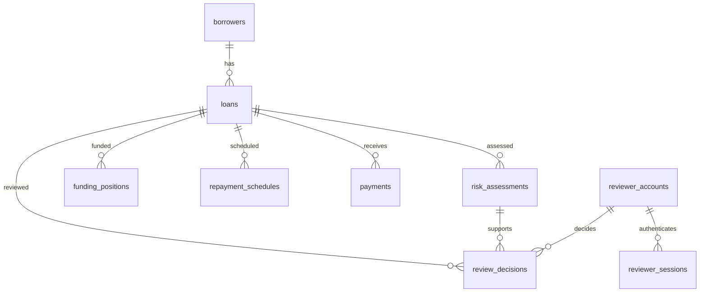

# Database schema

SQLite is the application store. The default mutable file is `data/runtime/riskora.db`; it is ignored by Git. `data/riskora.db` is a historical demonstration database, copied only on the first default startup. Tests create temporary databases and do not modify either application file.

## Relationships

The diagram shows declared foreign keys. `payments.schedule_id`, `risk_assessments.reviewer_id` and audit entity/reviewer references are application-managed references, not declared foreign keys. The legacy `users` table is separate from login accounts.

## Table definitions

The tables below were generated from `PRAGMA table_info` and `PRAGMA foreign_key_list` on a fresh isolated database initialized by the current code. PK marks the declared primary key. Required reflects the column's explicit NOT NULL flag; SQLite primary-key behavior must also be considered. No claim is made that domain ranges are database CHECK constraints: those are validated by the API.

### `users`

Historical reviewer labels. These rows cannot sign in.

| Column | SQLite type | PK | Required | Default | Foreign key |
|---|---|---|---|---|---|
| id | TEXT | Yes | No | None | None |
| username | TEXT | No | Yes | None | None |
| full_name | TEXT | No | Yes | None | None |
| role | TEXT | No | Yes | 'RISK_UNDERWRITER' | None |
| created_at | TIMESTAMP | No | No | CURRENT_TIMESTAMP | None |

### `borrowers`

Borrower identity and demographic/employment inputs. Missing optional intake values remain NULL.

| Column | SQLite type | PK | Required | Default | Foreign key |
|---|---|---|---|---|---|
| id | TEXT | Yes | No | None | None |
| name | TEXT | No | Yes | None | None |
| age | INTEGER | No | No | None | None |
| income | REAL | No | Yes | None | None |
| education | TEXT | No | No | None | None |
| employment_type | TEXT | No | No | None | None |
| months_employed | INTEGER | No | No | None | None |
| marital_status | TEXT | No | No | None | None |
| has_dependents | TEXT | No | No | 'No' | None |
| has_mortgage | TEXT | No | No | 'No' | None |
| has_cosigner | TEXT | No | No | 'No' | None |
| created_at | TIMESTAMP | No | No | CURRENT_TIMESTAMP | None |

### `loans`

Requested loan terms and current workflow stage. New IDs use an LR- prefix and UUID suffix.

| Column | SQLite type | PK | Required | Default | Foreign key |
|---|---|---|---|---|---|
| id | TEXT | Yes | No | None | None |
| borrower_id | TEXT | No | Yes | None | borrowers.id (delete CASCADE) |
| loan_amount | REAL | No | Yes | None | None |
| credit_score | INTEGER | No | No | None | None |
| dti_ratio | REAL | No | No | None | None |
| num_credit_lines | INTEGER | No | No | None | None |
| interest_rate | REAL | No | No | None | None |
| loan_term | INTEGER | No | No | None | None |
| loan_purpose | TEXT | No | No | None | None |
| status | TEXT | No | No | 'REQUEST_RECEIVED' | None |
| created_at | TIMESTAMP | No | No | CURRENT_TIMESTAMP | None |

### `risk_assessments`

Append-only assessment history in normal API use, including input snapshot and model version. The latest applicable row supplies the current risk result.

| Column | SQLite type | PK | Required | Default | Foreign key |
|---|---|---|---|---|---|
| id | INTEGER | Yes | No | None | None |
| loan_id | TEXT | No | Yes | None | loans.id (delete CASCADE) |
| model_version | TEXT | No | Yes | None | None |
| probability_of_default | REAL | No | Yes | None | None |
| risk_score | INTEGER | No | Yes | None | None |
| risk_level | TEXT | No | Yes | None | None |
| data_quality_score | INTEGER | No | Yes | None | None |
| anomaly_detected | INTEGER | No | Yes | 0 | None |
| review_level | TEXT | No | Yes | None | None |
| drivers_json | TEXT | No | No | None | None |
| protective_json | TEXT | No | No | None | None |
| dq_details_json | TEXT | No | No | None | None |
| anomaly_details_json | TEXT | No | No | None | None |
| assessed_at | TIMESTAMP | No | No | CURRENT_TIMESTAMP | None |
| input_snapshot_json | TEXT | No | No | None | None |
| reviewer_id | INTEGER | No | No | None | None |

### `funding_positions`

Saved simulated funding commitments. JSON holds the lender positions; the API prevents a second commitment for the same loan.

| Column | SQLite type | PK | Required | Default | Foreign key |
|---|---|---|---|---|---|
| id | INTEGER | Yes | No | None | None |
| loan_id | TEXT | No | Yes | None | loans.id (delete CASCADE) |
| mode | TEXT | No | Yes | None | None |
| herfindahl_index | REAL | No | No | None | None |
| concentration_rating | TEXT | No | No | None | None |
| positions_json | TEXT | No | Yes | None | None |
| funded_at | TIMESTAMP | No | No | CURRENT_TIMESTAMP | None |

### `repayment_schedules`

Versioned repayment plans. The row ID is the version sent when recording payments. The latest row is active.

| Column | SQLite type | PK | Required | Default | Foreign key |
|---|---|---|---|---|---|
| id | INTEGER | Yes | No | None | None |
| loan_id | TEXT | No | Yes | None | loans.id (delete CASCADE) |
| schedule_type | TEXT | No | Yes | None | None |
| allocation_policy | TEXT | No | Yes | None | None |
| principal | REAL | No | Yes | None | None |
| annual_rate | REAL | No | Yes | None | None |
| term_months | INTEGER | No | Yes | None | None |
| indicative_emi | REAL | No | Yes | None | None |
| total_interest | REAL | No | Yes | None | None |
| total_repayable | REAL | No | Yes | None | None |
| installments_json | TEXT | No | Yes | None | None |
| created_at | TIMESTAMP | No | No | CURRENT_TIMESTAMP | None |

### `payments`

Recorded receipt events and actual lender allocations. New events include schedule linkage and idempotency reference.

| Column | SQLite type | PK | Required | Default | Foreign key |
|---|---|---|---|---|---|
| id | INTEGER | Yes | No | None | None |
| loan_id | TEXT | No | Yes | None | loans.id (delete CASCADE) |
| installment_num | INTEGER | No | Yes | None | None |
| amount_paid | REAL | No | Yes | None | None |
| paid_date | TIMESTAMP | No | No | CURRENT_TIMESTAMP | None |
| allocations_json | TEXT | No | Yes | None | None |
| schedule_id | INTEGER | No | No | None | None |
| idempotency_key | TEXT | No | No | None | None |

### `audit_logs`

Application events with entity, reviewer and JSON context. These records are not tamper-proof or cryptographically chained.

| Column | SQLite type | PK | Required | Default | Foreign key |
|---|---|---|---|---|---|
| id | INTEGER | Yes | No | None | None |
| event_type | TEXT | No | Yes | None | None |
| entity_id | TEXT | No | No | None | None |
| reviewer | TEXT | No | No | None | None |
| details_json | TEXT | No | No | None | None |
| created_at | TIMESTAMP | No | No | CURRENT_TIMESTAMP | None |

### `reviewer_accounts`

Actual login accounts. Salt and password_hash must never be included in API responses or published backups.

| Column | SQLite type | PK | Required | Default | Foreign key |
|---|---|---|---|---|---|
| id | INTEGER | Yes | No | None | None |
| username | TEXT | No | Yes | None | None |
| salt | TEXT | No | Yes | None | None |
| password_hash | TEXT | No | Yes | None | None |
| role | TEXT | No | Yes | None | None |

### `reviewer_sessions`

SHA-256 hashes of random session tokens, account link and expiry as Unix seconds. The raw token is not stored here.

| Column | SQLite type | PK | Required | Default | Foreign key |
|---|---|---|---|---|---|
| token_hash | TEXT | Yes | No | None | None |
| account_id | INTEGER | No | Yes | None | reviewer_accounts.id (delete NO ACTION) |
| expires_at | REAL | No | Yes | None | None |

### `review_decisions`

Human decisions linked to a particular assessment and authenticated reviewer, with a required review note.

| Column | SQLite type | PK | Required | Default | Foreign key |
|---|---|---|---|---|---|
| id | INTEGER | Yes | No | None | None |
| loan_id | TEXT | No | Yes | None | loans.id (delete NO ACTION) |
| assessment_id | INTEGER | No | Yes | None | risk_assessments.id (delete NO ACTION) |
| decision | TEXT | No | Yes | None | None |
| note | TEXT | No | Yes | None | None |
| reviewer_id | INTEGER | No | Yes | None | reviewer_accounts.id (delete NO ACTION) |
| created_at | TEXT | No | No | CURRENT_TIMESTAMP | None |

### `schema_migrations`

Additive migration marker. Version 2 identifies the integration schema; this is not a general migration framework.

| Column | SQLite type | PK | Required | Default | Foreign key |
|---|---|---|---|---|---|
| version | INTEGER | Yes | No | None | None |
| applied_at | TEXT | No | No | CURRENT_TIMESTAMP | None |

## Indexes and transaction rules

Primary keys and username uniqueness create SQLite indexes. The integration adds a unique partial index named `payment_request_key` on non-NULL `payments.idempotency_key`. This allows historical NULL references while rejecting duplicate new keys. The schema does not declare a unique loan_id on funding or a foreign key on the added payment schedule column; workflow guards supply those checks.

`get_connection()` enables foreign keys and uses a transaction context, committing successful work and rolling back exceptions before closing. Profile edits, review decisions and receipt operations use explicit write transactions where needed. Payment recording performs duplicate checks, schedule checks, exact-cent allocation, insertion and installment-state update together.

## JSON column contracts

| Column | Stored content | Consumer |
|---|---|---|
| assessment drivers/protective JSON | Policy-rule factors with label, feature, value and fixed impact points | Analysis and report |
| `dq_details_json` | Completeness, missing inputs, warnings, contradictions and verification readiness | Queue, review guard and ORA |
| `anomaly_details_json` | Anomaly indicators and review context | Analysis and report |
| `input_snapshot_json` | Normalized borrower fields used for the saved assessment | Evidence and traceability |
| `positions_json` | Simulated lender IDs/names, invested amounts and shares | Funding, repayment and exposure |
| `installments_json` | Due dates, planned principal/interest, lender allocations and actual paid state | Repayment UI and receipt checks |
| `allocations_json` | Actual lender principal, interest and total allocation for one receipt | Outstanding balances and audit |
| `details_json` | Event-specific metadata | Audit inspection |

JSON is serialized text, not separate relational child tables. Validation and aggregation happen in Python. Direct SQL edits can violate assumptions the API normally enforces. Do not edit financial JSON to make a dashboard total appear correct.

## Migration and legacy records

Startup creates missing tables, checks columns before adding snapshot/reviewer and schedule/reference fields, and creates the partial reference index. It maps historical `FUNDING_OPTIMIZED` to `FUNDED` and `FULLY_PAID` to `CLOSED`. It does not delete old assessments, payments or schedules.

Legacy assessment snapshots and reviewer links can be NULL. They cannot retroactively prove who supplied the input. Historical payment rows without schedule IDs are ambiguous, particularly when the same installment number occurs more than once. The API reports `requires_reconciliation=true`, returns unknown outstanding principal and blocks new payments for those cases. A reviewed reconciliation process remains future work; no migration guesses allocations or removes duplicates automatically.

## Accounting invariants

For each new receipt, amount paid equals the sum of lender total allocations. Each lender total equals principal plus interest. Cumulative receipts for an installment cannot exceed its scheduled payment. Outstanding principal equals original principal less all recorded principal allocations, while total received includes both principal and interest. Schedule changes are blocked after receipts to preserve these relationships.

Amounts are stored as SQLite REAL and monetary JSON numbers for compatibility. The payment service converts to integer cents for allocation. This is not a double-entry accounting schema and does not model bank settlement, refunds, write-offs or accrued late fees.

## Backup and inspection

Stop the server before copying its database, or use SQLite's backup API for a live consistent snapshot. Keep backups outside Git with restricted access. Restore to a separate filename, set `RISKORA_DB_PATH`, and verify workflows before replacing the active file. Back up before upgrades; rollback is restoration of a reviewed application/artifact/database set, not an automatic down-migration.

Useful read-only checks on an offline copy include `PRAGMA integrity_check`, `PRAGMA foreign_key_check`, table row counts and reconciliation of each receipt's JSON allocations. Passing integrity checks proves storage consistency, not the correctness of historical business events. See README for the recovery procedure and TESTING.md for database isolation.
