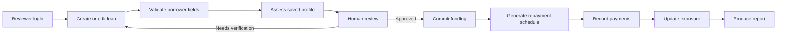

# RISKORA

AI-assisted micro-lending risk assessment and decision support. RISKORA is a local reviewer workstation built with Python, Tornado, SQLite and a browser frontend. It combines a synthetic-data credit-risk model with explicit human review, simulated funding commitments, repayment schedules and a receipt ledger.

The October 2026 OraAgent integration adds authenticated reviewer accounts, borrower create/edit forms, evidence summaries, recorded review decisions and partial-payment handling to the existing application. It uses one backend and one database. See [INTEGRATION.md](INTEGRATION.md) for the source archive and adaptation choices.

**Scope:** this is an academic application and workflow prototype. Predictions are trained on synthetic data. Funding positions are simulated, and recording a receipt does not move money. ORA is a deterministic evidence summary, not an autonomous agent or an external verification service.

## Contents

- [Setup and first login](#setup-and-first-login)
- [Configuration](#configuration)
- [Reviewer workflow](#reviewer-workflow)
- [Risk and accounting semantics](#risk-and-accounting-semantics)
- [Repository map](#repository-map)
- [Verification](#verification)
- [Operations and recovery](#operations-and-recovery)
- [Troubleshooting](#troubleshooting)
- [Documentation](#documentation)

## Setup and first login

Use CPython **3.14**, matching `.python-version`, the supplied serialized model and the CI configuration. Runtime dependencies, including transitive packages, are pinned in `requirements.txt`. Node is only needed for JavaScript syntax checks; the frontend has no npm build step. Run commands from the repository root.

### Windows PowerShell

```powershell
git clone https://github.com/HarshidGiriver/RISKORA_MicroLending_Agentic_AI.git
Set-Location RISKORA_MicroLending_Agentic_AI
py -3.14 -m venv .venv
.\.venv\Scripts\python.exe -m pip install -r requirements.txt
.\.venv\Scripts\python.exe -m pip check
.\.venv\Scripts\python.exe run.py --check
.\.venv\Scripts\python.exe run.py
```

Calling the interpreter directly avoids changing PowerShell execution policy to activate an environment.

### Linux or macOS

```bash
git clone https://github.com/HarshidGiriver/RISKORA_MicroLending_Agentic_AI.git
cd RISKORA_MicroLending_Agentic_AI
python3.14 -m venv .venv
.venv/bin/python -m pip install -r requirements.txt
.venv/bin/python -m pip check
.venv/bin/python run.py --check
.venv/bin/python run.py
```

The server normally listens at `http://127.0.0.1:8000/`. If a port is occupied it tries up to nine subsequent ports; use the URL printed in the terminal. Keep the same hostname throughout a session because cookies are host-specific. Stop the server with Ctrl+C.

On first use, open the application on the server computer and create the initial administrator. Choose a username of 3–80 characters and a password of 12–200 characters. There is no published default password. First-use account creation is allowed only through a loopback connection and closes after an account exists. Sign in afterward. An administrator can create ADMIN, REVIEWER or VIEWER accounts in the application.

`run.py --check` checks dataset presence and validates the model, preprocessor and metrics together. It does not start HTTP, train a model, initialize SQLite or create accounts. A successful check alone does not prove that every workflow works; run the regression suite too.

## Configuration

`.env.example` is a reference, **not an automatically loaded configuration file**. Set variables in the shell before starting Python. Relative paths resolve from the repository root.

| Variable | Default | Purpose |
|---|---|---|
| `RISKORA_HOST` | `127.0.0.1` | HTTP bind address; local-only by default |
| `RISKORA_PORT` | `8000` | Preferred port; positional CLI port takes precedence |
| `RISKORA_DB_PATH` | `data/runtime/riskora.db` | Mutable SQLite database |
| `RISKORA_DATA_PATH` | `data/loan_default_full.csv` | Synthetic dataset used by the explorer |
| `RISKORA_ARTIFACTS_DIR` | `ml/artifacts` | Matching model, preprocessor and metrics directory |

Example: use a separate demonstration database without touching normal reviewer data.

```powershell
$env:RISKORA_DB_PATH = 'data/runtime/faculty-demo.db'
.\.venv\Scripts\python.exe run.py 8010
# After stopping this process:
Remove-Item Env:RISKORA_DB_PATH
```

On POSIX shells: `RISKORA_DB_PATH=data/runtime/faculty-demo.db .venv/bin/python run.py 8010`.

The default first startup copies the historical tracked `data/riskora.db` into `data/runtime/riskora.db` if the runtime file is absent. Custom database paths do not import that historical database. An empty database receives six demonstration loans and a historical reviewer label, but no login credentials. Runtime accounts, sessions and new transactions remain in the ignored runtime directory.

## Reviewer workflow



1. **Create a loan.** Enter the borrower name and model inputs. Income is annual INR; loan term and employment tenure are months; DTI is a ratio. The frontend loads allowed values from `/api/schema` and the backend validates them again.
2. **Assess the saved case.** The service runs input-quality checks, anomaly indicators and the calibrated model. Missing optional intake fields remain visibly missing. An assessment can exist while the case still needs verification.
3. **Review the evidence.** ORA shows the saved model result, input snapshot reference and data-quality concerns. Record APPROVED, REJECTED or NEEDS_VERIFICATION with a note. Approval requires complete inputs and the latest assessment.
4. **Commit funding.** A preview does not save a commitment. The saved action requires approval and the exact saved principal. Splitting participation changes concentration, not borrower default probability.
5. **Generate a schedule.** Use the approved principal, rate and term. The server restores lender positions from its database. A replacement schedule is permitted before any receipts; afterward it is blocked.
6. **Record a receipt.** Supply the installment, positive amount and a unique payment reference. Partial receipts are supported. Retry an uncertain submission with the same reference, not a new reference.
7. **Resume and report.** Reloading a case restores saved funding, schedule, receipts and outstanding principal. Review exposure and open the decision report. Browser printing can save a PDF of that case.

The implemented stored stages are `REQUEST_RECEIVED`, `NEEDS_VERIFICATION`, `RISK_ASSESSED`, `APPROVED`, `REJECTED`, `FUNDED`, `REPAYMENT_CONFIGURED`, `REPAYING` and `CLOSED`. Separate persisted Draft and Submitted stages are future work. Editing an unfunded case requires reassessment; reanalysis does not reset a funded or repaying case to an intake stage. See [ARCHITECTURE.md](ARCHITECTURE.md) for transition guards.

## Risk and accounting semantics

| Display | Source and meaning |
|---|---|
| Probability of default | Calibrated HistGradientBoosting model on the normalized input |
| Risk band | LOW below 8% PD, MEDIUM from 8% to below 20%, HIGH at 20% or above |
| Display score | Piecewise transformation of PD, bounded to 5–99; not a bureau score |
| Driver/protective points | Fixed policy-rule indicators, not SHAP values or model contributions |
| Global coefficient chart | Logistic-regression baseline coefficients, not the deployed tree model |
| Dataset explorer estimate | Separate heuristic estimate over synthetic records; not saved-case inference |
| ORA brief | Deterministic summary of available assessment and borrower inputs |
| Concentration | Distribution of a loan across simulated lender positions |
| Outstanding principal | Original principal less principal allocated from actual recorded receipts |

Money is displayed with two decimal places. Payment allocation uses integer cents internally so each receipt exactly reconciles across lender principal and interest buckets. Interest paid does not reduce outstanding principal. The SQLite schema retains REAL amounts and JSON schedule structures; it is not a general-purpose double-entry ledger.

Historical receipts lacking a schedule link cannot be safely allocated by guessing an installment number. Those cases show a reconciliation warning, return unknown outstanding principal and block further receipts. The application does not yet include a reconciliation editor, refund flow, charge-off flow or bank settlement integration.

## Repository map

```text
run.py                         validated application entrypoint
index.html / styles.css        workstation layout and responsive presentation
app.js                         core queue, analysis, funding, repayment and reports
integration.js                 login, intake, review, accounts and payment dialogs
backend/config.py              environment and project-relative paths
backend/schema.py              shared aliases, types, bounds and inference fallbacks
backend/server.py              Tornado routes, orchestration and static allowlist
backend/integration.py         setup/accounts, edit, review and audit endpoints
backend/security.py            password hashing and revocable sessions
backend/database.py            SQLite connections, additive migration and demo seed
backend/services/              quality, anomaly, funding, repayment, ORA and receipts
ml/generate_data.py             explicit synthetic-data generation
ml/train.py                     explicit training and evaluation
ml/infer.py                     artifact loading, PD prediction and policy indicators
ml/artifacts/                  model, preprocessor and model_metrics.json
assets/                        public application images/video
data/loan_default_full.csv     committed synthetic dataset
data/riskora.db                historical demonstration database
data/runtime/                 ignored live database directory
tests/                         isolated service and HTTP regression tests
.github/workflows/tests.yml    Linux/Windows checks
output/                        retained review and integration deliverables
```

The received ZIP and extracted copy are not runtime dependencies. There is no second FastAPI server to start and no replacement model to copy from the ZIP.

## Verification

```powershell
.\.venv\Scripts\python.exe -m unittest discover -s tests -v
.\.venv\Scripts\python.exe -m pip check
.\.venv\Scripts\python.exe run.py --check
node --check app.js
node --check integration.js
```

Tests create temporary SQLite databases through `tests/support.py`; they do not use live application accounts or receipts. `pytest.ini` limits optional pytest discovery to `tests/`; unittest is the supported dependency-free runner included in CI. See [TESTING.md](TESTING.md) for the test map, browser checks, evidence and limits.

## Operations and recovery

Keep the server local for demonstrations. Binding to `0.0.0.0` is not a complete deployment plan. Remote service operation requires a reviewed HTTPS proxy configuration, process supervision, controlled account provisioning, protected backups, monitoring and load testing. These are not supplied as a production deployment package.

For a consistent backup, stop the server and copy the database selected by `RISKORA_DB_PATH` to a protected location outside Git. Record the application commit and model version alongside it. For online backups use SQLite's backup API rather than copying an active file without its transaction state. Never publish a runtime backup: it contains account hashes, sessions and borrower information.

To test recovery, restore the backup to a **different** runtime filename, set `RISKORA_DB_PATH` to that file and start on a separate local port. Check loan counts, decisions, funding, schedule IDs, receipt allocations and outstanding balances. Do not replace the original database until the restored copy has been checked. Existing unexpired sessions may be present in a backup; session revocation is an operational concern after recovery.

Schema changes currently use additive startup migration and a version marker, not a full upgrade/downgrade framework. Before upgrading, stop the application, back up its database and retain a matching source/artifact revision. Do not independently mix model and preprocessor files or run retraining as a repair for a dependency mismatch.

## Troubleshooting

| Symptom | What to check |
|---|---|
| Import or model compatibility error | Use Python 3.14 in the intended environment; install pinned requirements and run `pip check` |
| Missing artifact | Restore all three files from the same revision; do not load an untrusted joblib file |
| Browser opens an old server | Read the terminal port; stop duplicate processes and reload the correct URL |
| `.env` changes have no effect | Export variables in the shell before launch; `.env` is not loaded |
| 401 after inactivity | Eight-hour session expired; sign in again |
| 403 on a POST | Check role, same origin and `X-Riskora-Request: 1` header |
| Initial setup unavailable | An account already exists, or the connection is not loopback |
| Approval blocked | Fill all 16 inputs, resolve quality concerns, assess again and reload latest assessment |
| Funding/schedule returns 409 | Check approval, saved terms, existing commitment and existing receipts |
| Payment returns 409 | Check current schedule ID, remaining amount, reference reuse and legacy reconciliation warning |
| Same borrower gives different scenario | Compare all 16 normalized fields and artifact revision; unchanged overrides must give zero delta |

There is no password-reset screen. Do not delete a live database to bypass login. Account recovery needs an administrator-led procedure that preserves financial records; this is listed as maintenance work.

## Documentation

| Guide | Contents |
|---|---|
| [API_DOCUMENTATION.md](API_DOCUMENTATION.md) | Authentication, endpoint contracts, payloads, retries and errors |
| [ARCHITECTURE.md](ARCHITECTURE.md) | Components, diagrams, state transitions and boundaries |
| [DATABASE_SCHEMA.md](DATABASE_SCHEMA.md) | Tables, keys, migration, JSON records and reconciliation |
| [DATA_DICTIONARY.md](DATA_DICTIONARY.md) | Every input, alias, unit, range, category and fallback |
| [ML_PIPELINE.md](ML_PIPELINE.md) | Generation, splits, preprocessing, training, calibration and inference |
| [MODEL_CARD.md](MODEL_CARD.md) | Artifact results, intended use and model limitations |
| [DEMO_GUIDE.md](DEMO_GUIDE.md) | Repeatable faculty walkthrough and expected outcomes |
| [FACULTY_QA.md](FACULTY_QA.md) | Evidence-based explanations for project review |
| [TESTING.md](TESTING.md) | Automated and manual verification procedures |
| [PROJECT_ANALYSIS.md](PROJECT_ANALYSIS.md) | Current implementation, gaps and ordered improvement plan |
| [INTEGRATION.md](INTEGRATION.md) | OraAgent source provenance and integration decisions |
| [RISKORA_Final_Review_Document.pdf](RISKORA_Final_Review_Document.pdf) | Current consolidated technical review |

Generate the current review PDF with `python -m pip install -r requirements-docs.txt`, then `python generate_final_review_pdf.py`. The generator reads maintained Markdown guides and saved metrics; it does not access the live database or retrain the model. Its default output is the root PDF above. The older `output/pdf/RISKORA_Review_2_Report.pdf` is a historical pre-integration submission, not the current implementation reference.
